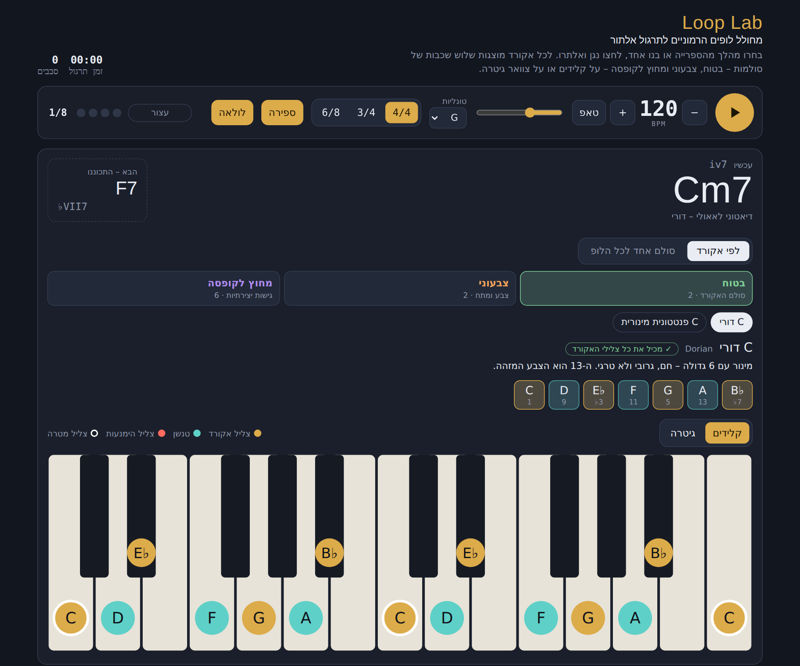

# Loop Lab

**Improvisation practice over chord progressions.**
Backing loops with scale suggestions for every chord, shown on keyboard and guitar.

🎹 **Try it:** https://boazbareket1.github.io/loop-lab

## What it does

- **Loop builder:** pick a progression from the library or build your own. Choose any of the 12 keys (spelled correctly for the key, e.g. B♭ and not A♯), 4/4, 3/4 or 6/8, tempo, count-in and loop.
- **Progression library:** 23 progressions grouped by style and level. Includes modal vamps, pop and rock, three blues forms (major, minor, jazz), jazz (ii–V–I, Rhythm Changes, Coltrane changes and more), Middle Eastern (Hijaz, Andalusian cadence, freylekhs), and funk and soul.
- **Scale suggestions in three tiers for every chord:**
  - **Safe:** the chord's own scale, chosen by what the chord is doing in the key (Dorian, Aeolian or Phrygian for a minor 7th chord, Lydian for IV, Phrygian dominant for a V7 that resolves to minor).
  - **Colorful:** Lydian, Altered, diminished, melodic minor and other richer choices.
  - **Outside:** pentatonics from other roots, upper-structure triads, side-slipping and bebop scales.
  - **World scales:** Hijaz / Freygish, Misheberakh, Hungarian minor, double harmonic, Bayati (approximated), Hirajoshi, In, blues.
- **One scale for the whole loop:** when one scale fits every chord it is shown. When none does, the tool says so, shows the closest scale and names the notes that need to change.
- **Live display:** the current chord is highlighted and the next one is shown in advance. The scale appears on keyboard or guitar neck, colored as chord tones, tensions and avoid notes. A guide-tone line shows the 3rds and 7ths moving by half steps between chords.
- **Accompaniment:** 10 drum styles (straight 8, swing, bossa, funk, ballad, maqsum, bulgar, jazz waltz, waltz, 6/8). Bass can play roots, a moving line, walking or a pedal. Comping on pad, piano or guitar, with close voice leading. Volume and mute for each instrument.
- **Practice modes:** Trade 4s, target note (land on the 3rd on beat 1), a new scale tier every cycle, creative limits (3 notes, one note, off-beats only), random key, speed trainer, and a library of your own saved loops.
- **Self-test:** every time the page loads, it checks all the "safe" and "colorful" suggestions in all 12 keys and confirms that each scale contains the chord's tones.

## Tech

A single HTML file with no build step and no dependencies. Sound is made with the Web Audio API. Saved loops stay in the browser (localStorage). Works on mobile.

---

# Loop Lab

**תרגול אלתור על מהלכים הרמוניים.**
לופים לליווי עם המלצות סולמות לכל אקורד, על קלידים ועל צוואר גיטרה.

🎹 **לכלי:** https://boazbareket1.github.io/loop-lab

## מה יש בכלי

- **בניית לופ:** בוחרים מהלך מהספרייה או בונים אחד. יש 12 טונליות בכתיב נכון (B♭ ולא A♯), משקל 4/4, 3/4 או 6/8, טמפו, ספירה לפני ההתחלה ולולאה.
- **ספריית מהלכים:** 23 מהלכים לפי סגנון ורמה: וואמפים מודאליים, פופ ורוק, שלושה סוגי בלוז (מז׳ורי, מינורי, ג׳אזי), ג׳אז (ii–V–I, Rhythm Changes, מהלך קולטריין ועוד), מזרחי (חיג׳אז, קדנצה אנדלוסית, פריילעך) ופאנק וסול.
- **המלצות סולמות בשלוש שכבות לכל אקורד:**
  - **בטוח:** הסולם של האקורד לפי התפקיד שלו בטונליות (למשל דורי, אאולי או פריגי על m7, לידי על IV, פריגי-דומיננטי על V7 שנפתר למינור).
  - **צבעוני:** לידי, אלטרד, דימיניש, מינור מלודי ועוד בחירות עשירות יותר.
  - **מחוץ לקופסה:** פנטטוניות משורשים אחרים, טריאדות מבנה עליון, side-slip וסולמות ביבופ.
  - **סולמות עולם:** חיג׳אז / פריגיש, מי שבירך, מינור הונגרי, הרמוני כפול, ביאת (בקירוב), היראג׳ושי, In ובלוז.
- **סולם אחד לכל הלופ:** אם יש סולם אחד שמתאים לכל האקורדים, הוא מוצג. אם אין, הכלי אומר את זה, מציג את הסולם הקרוב ביותר ומציין אילו צלילים צריך לשנות.
- **תצוגה בזמן נגינה:** האקורד הנוכחי מודגש והבא מוצג מראש. הסולם מופיע על קלידים או על צוואר גיטרה, בצבעים שונים לצלילי אקורד, לטנשנים ולצלילי הימנעות. קו צלילי מנחה מראה איך הטרצות והספטימות זזות בחצאי טונים בין האקורדים.
- **ליווי:** 10 סגנונות תופים (סטרייט 8, סווינג, בוסה, פאנק, בלדה, מקסום, בולגר, ואלס ג׳אז, ואלס ו-6/8). הבס מנגן שורשים, קו נע, walking או פדאל. קומפינג בפד, פסנתר או גיטרה עם הובלת קולות קרובה. עוצמה והשתקה לכל כלי.
- **מצבי תרגול:** Trade 4s, צליל מטרה (נחיתה על הטרצה בפעמה 1), שכבת סולמות חדשה בכל סבב, מגבלות יצירתיות (3 צלילים, צליל אחד, רק פעמות לא מודגשות), טונליות אקראית, מאמן מהירות וספרייה של לופים שמורים משלכם.
- **בדיקה עצמית:** בכל טעינה הכלי בודק את כל ההמלצות בשכבות "בטוח" ו"צבעוני" בכל 12 הטונליות, ומוודא שכל סולם מכיל את צלילי האקורד.

## טכנולוגיה

קובץ HTML יחיד, בלי בנייה ובלי תלויות. הסאונד נוצר ב-Web Audio API. לופים שמורים נשארים בדפדפן (localStorage). עובד גם בנייד.

---

© Boaz Bareket · [boaz-bareket.com](https://boaz-bareket.com)
